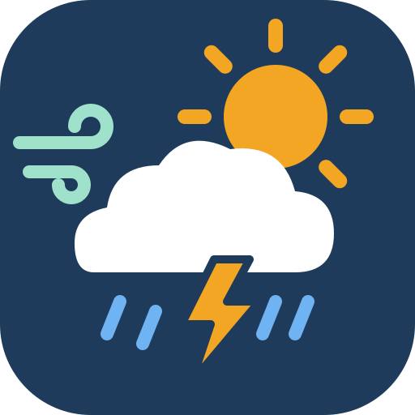

# WeatherScope

Animated weather maps for Home Assistant dashboards: rain radar, satellite, lightning, wind (with animated wind lines), rain and temperature forecast with isobars, highs and lows.

**Home Assistant downloads all map data itself.** Your dashboards – for example wall tablets – only talk to Home Assistant and never need internet access.

> 🇩🇪 [Deutsche Anleitung weiter unten](#deutsch)

## Maps

| Map | Source | Coverage |
|---|---|---|
| Weather radar, past 3 h + 1 h nowcast | Deutscher Wetterdienst (DWD) | Germany and surroundings |
| Satellite (visible, blue, infrared) | EUMETSAT (MTG, every 10 min) | Europe, Africa, Atlantic |
| Lightning, live | [Blitzortung](https://github.com/mrk-its/homeassistant-blitzortung) integration (optional) | worldwide |
| Wind, rain, temperature, isobars – 5 days | Open-Meteo | worldwide |

More radar sources (other countries) are welcome – see *Contributing*.

## Weather data

Unless switched off in the setup, WeatherScope also provides weather data for your home location (Open-Meteo, worldwide, updated every 15 minutes):

- `weather.weatherscope` – current weather with hourly (48 h) and daily (10 days) forecast; works with every weather card
- Sensors: air quality index, PM2.5, PM10, NO₂, O₃, CO, SO₂, UV index, visibility, precipitation today, sunrise, sunset
- Moon (calculated locally): phase, illumination, moonrise, moonset, next full moon
- Climate normals 1991–2020 (average high, low and rain for every month)

## Installation

1. Home Assistant → **Settings → Marketplace** → ⋮ → **Custom repositories** → add `https://github.com/candidiedm/weatherscope` as *Integration*.
2. Install **WeatherScope** and restart Home Assistant.
3. **Settings → Devices & services → Add integration → WeatherScope.** Choose the map centre and the map width (750 km shows all of Germany; a margin around it is loaded automatically).
4. Add the card to a dashboard:

```yaml
type: custom:weatherscope-card
entity: sensor.weatherscope_map_data
```

The card is loaded automatically by the integration – you don't need to add a resource.

### Weather cards

| Card | Shows |
|---|---|
| `custom:weatherscope-now-card` | Place, temperature, condition, today's high and low |
| `custom:weatherscope-hourly-card` | Hourly forecast: temperature, precipitation (amount and probability), wind and gusts |
| `custom:weatherscope-sky-card` | Animated sky as background of the whole page (sun, clouds, rain, snow, thunderstorm, fog, night) |

Every card has a visual editor and the same three backgrounds: *own sky* (default), *glass* (for a page with the animated sky behind it) and *transparent*. Values come from `weather.weatherscope` by default; you can pick any other weather entity and, where it makes sense, your own sensors (e.g. your weather station).

### Card options

| Option | Default | Meaning |
|---|---|---|
| `entity` | – | The *Map data* sensor of the integration (required) |
| `fit` | `cover` | `cover` fills the card, `contain` shows the whole map |
| `zoom` | `1` | Extra zoom factor |
| `cx`, `cy` | `0.5` | Which point of the map is centred (0–1) |

## Data sources and terms

- **Open-Meteo** – free for non-commercial use, [CC BY 4.0](https://open-meteo.com/en/license). The maps ask for a 32 × 33 grid four times a day (about 4,200 of the 10,000 free daily calls); the weather data adds about 200 calls a day.
- **DWD** – [open data](https://www.dwd.de/EN/service/copyright/copyright_node.html), attribution required.
- **EUMETSAT** – [view service](https://view.eumetsat.int), attribution required.
- **Blitzortung.org** – community network, non-commercial use only.
- **Natural Earth** – public domain (borders, lakes, rivers, city names).

## Contributing

Each radar source is a small, separate piece of code. If you know an open radar service for your country, open an issue or a pull request.

---

## Deutsch

WeatherScope zeigt animierte Wetterkarten im Dashboard: Wetterradar, Satellit, Blitze, Wind mit animierten Windstrichen, Regen- und Temperaturvorhersage mit Isobaren sowie Hoch- und Tiefdruckgebieten.

**Home Assistant lädt alle Kartendaten selbst.** Die Dashboards, zum Beispiel Wandtablets, sprechen nur mit Home Assistant und brauchen keinen Internetzugang.

### Einrichtung

1. Home Assistant → **Einstellungen → Marketplace** → ⋮ → **Benutzerdefinierte Repositories** → `https://github.com/candidiedm/weatherscope` als *Integration* hinzufügen.
2. **WeatherScope** installieren und Home Assistant neu starten.
3. **Einstellungen → Geräte & Dienste → Integration hinzufügen → WeatherScope.** Kartenmittelpunkt und Kartenbreite wählen (750 km zeigen ganz Deutschland; rundherum wird automatisch etwas mehr geladen).
4. Karte im Dashboard einfügen:

```yaml
type: custom:weatherscope-card
entity: sensor.weatherscope_map_data
```

Wetterradar gibt es derzeit für Deutschland (DWD). Satellit, Blitze und die Vorhersagekarten funktionieren auch außerhalb.

### Wetterdaten

Wenn bei der Einrichtung nicht ausgeschaltet, liefert WeatherScope zusätzlich Wetterdaten für dein Zuhause (Open-Meteo, weltweit, alle 15 Minuten): eine Wetter-Entität `weather.weatherscope` mit Stunden- und 10-Tage-Vorhersage, Sensoren für Luftqualität, UV, Sichtweite, Niederschlag, Sonnenauf- und -untergang, Mond (Phase, Beleuchtung, Auf- und Untergang, nächster Vollmond) und Klimawerte 1991–2020.
